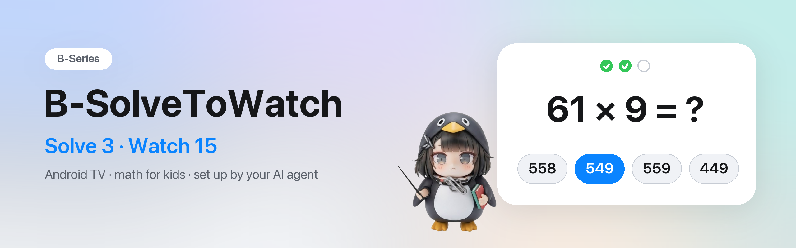
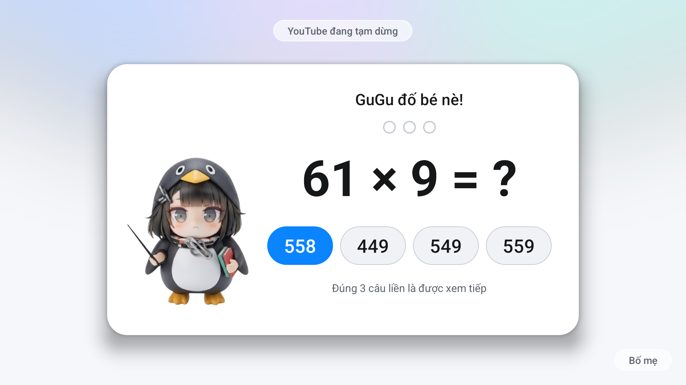
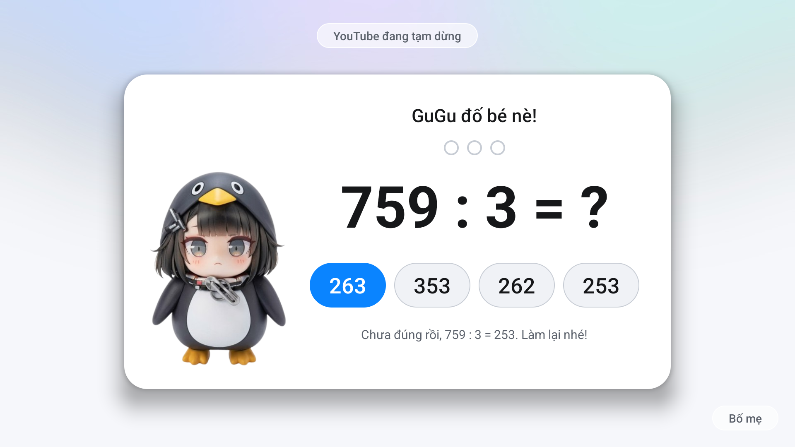
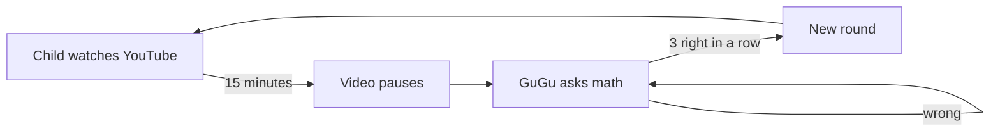

<p align="center">
  
</p>

<p align="center">
  
  
  
  <a href="LICENSE"></a>
</p>

<p align="center"><a href="README.md">Tiếng Việt</a> · <b>English</b></p>

**Watch YouTube for 15 minutes, solve 3 math problems, keep watching.** B-SolveToWatch (*GuGu Toán* on the TV) turns a
child's TV time into short bursts of math practice: when a round is up the video pauses, GuGu the penguin asks a question,
and three right answers in a row let the video play on. No arguments, no grabbing the remote.

You don't need to code: **hand this repo to your AI coding assistant** (Claude Code, Codex, Gemini CLI…) and it builds
the app and installs it on your TV, for your child's grade.

> **If you are an AI agent:** read [AGENTS.md](AGENTS.md) and follow it from step 1.

| | |
|---|---|
|  |  |
| *Round over: the video pauses, GuGu asks, the remote answers* | *Wrong: GuGu shows the right answer, start again* |

## Quick start

Open your AI assistant on a computer on the same Wi-Fi as the TV and say:

```
Clone https://github.com/haobv/B-SolveToWatch and follow its instructions.
```

It reads the repo, asks you a few questions, installs the app on your TV and tests it with you: about **15–20 minutes**.
All you do is switch on debugging on the TV and press *Allow* when the TV asks.

<details>
<summary><b>What you need</b></summary>

1. **An Android TV / Google TV**, Android 8 or newer: TCL, Sony, Xiaomi, Philips, Hisense Google TV models…
   Samsung, LG and Roku TVs won't work.
2. **Debugging on:** Settings → System (or Device Preferences) → About → press OK on **Android TV OS build** 7 times →
   back → Developer options → **USB debugging** on (and Network/ADB debugging if you see it).
3. **A computer on the same Wi-Fi**, with an AI assistant that can run commands. It asks before installing tools
   (JDK 17, Android SDK, adb).
4. When it connects, the TV shows **"Allow USB debugging?"**: tick *Always allow* and press OK.
</details>

## How it works



An accessibility service reads only **which app is on screen** to count the time. When a round is used up it pauses the
video and opens the quiz. Back doesn't leave it; Home does, but opening YouTube again brings the quiz straight back.

## Features

| | |
|---|---|
| 🧮 **Real curriculum** | Grade 3 of Vietnam's 2018 programme: +/− within 1000, times tables, two-step expressions. Wrong choices sit close to the answer, so guessing doesn't work |
| 🐧 **GuGu** | Asks as a teacher, frowns at a wrong answer, cheers when the round is won. Swap in your own character |
| 🎯 **Personal** | Grade, the child's name, gated apps, minutes, streak, language: the AI asks and builds it |
| 🔒 **Parents in charge** | PIN; snooze for 1 h, 3 h or the rest of the day; today's stats |
| 📺 **Made for the remote** | Big type, arrow keys, a light Liquid Glass look |
| 🛡️ **Private** | No internet permission, no ads, no accounts; never removes or disables the TV's apps |

## What the AI asks

| Question | Default |
|---|---|
| The child's grade | 3 |
| What GuGu calls the child ("GuGu đố **Bin** nè!") | bé |
| Which apps to gate (it lists the TV's apps) | YouTube |
| Minutes per round, right answers in a row | 15, 3 |
| Character: GuGu, your own picture, or none | GuGu |

## Parent settings on the TV

Open **GuGu Toán** from the TV's app list (or press **Bố mẹ** on the quiz) and enter the PIN: on/off, minutes per round,
answers in a row, snooze, change PIN, and how long the child watched and answered today. **The PIN starts as `0000`:
change it right after setup.**

It is a fence for young children, not a lock: anyone who knows *Settings → Apps → Force stop* can turn it off.

## Roadmap

- [x] Grade 3, YouTube gate, GuGu, AI-agent setup
- [ ] Grades 1, 2, 4, 5 (outlined in [docs/curriculum.md](docs/curriculum.md))
- [ ] English on screen
- [ ] Notes for more TV brands ([docs/devices.md](docs/devices.md))

## Contributing

A new grade, a TV brand, a fix: see *Changing this repo* in [AGENTS.md](AGENTS.md). One topic per pull request, with a
screenshot from a real TV for anything the child sees.

## Credits and licence

- The "hand the repo to your AI" setup is learned from [CleanYourTV](https://github.com/Gathin23/cleanyourtv), which strips
  ads and replaces the launcher on Android TVs: the two go well together.
- Code: [MIT](LICENSE). GuGu character pictures: © haobv, free to use in this app, not for commercial use
  ([ASSETS-LICENSE.md](ASSETS-LICENSE.md)).

---

<p align="center"><sub><b>B-Series</b> by <a href="https://github.com/haobv">haobv</a> ·
<a href="https://github.com/haobv/B-SolveToWatch">B-SolveToWatch</a> ·
<a href="https://github.com/haobv/B-AutoLearn">B-AutoLearn</a></sub></p>
