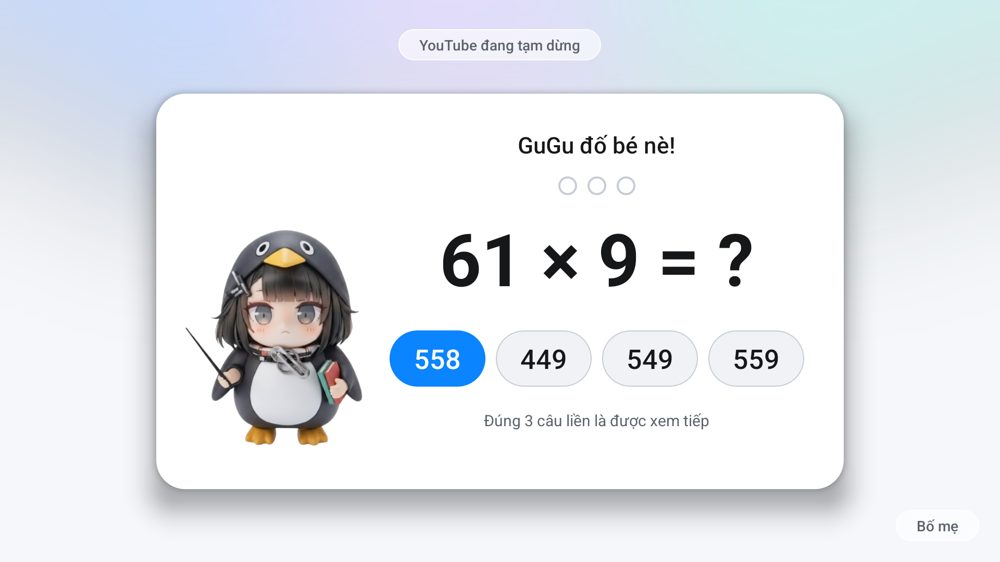
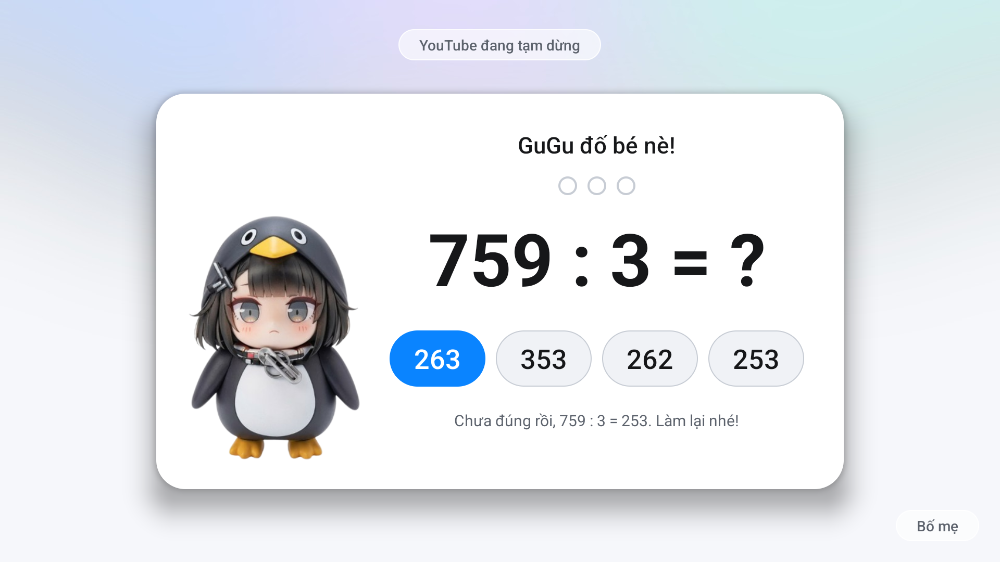

# Solve to Watch · GuGu Toán

**Xem YouTube 15 phút, giải 3 bài toán đúng thì được xem tiếp.**
Ứng dụng nhỏ cho Android TV / Google TV: khi bé xem đủ một lượt, video tạm dừng và nhân vật GuGu ra đố toán.
Đúng liền 3 câu là video chạy tiếp; sai thì làm lại từ đầu. Bố mẹ có mã PIN để tắt hoặc chỉnh.

> **Nếu bạn là AI agent:** đọc [AGENTS.md](AGENTS.md) và làm theo, từ bước 1.

| | |
|---|---|
|  |  |
| *Hết lượt xem: GuGu đố toán, chọn đáp án bằng remote* | *Sai thì GuGu báo đáp án đúng, làm lại từ đầu* |

## Cách dùng: nhờ AI làm hết

Repo này không cần bạn tự build. Bạn chỉ cần một **trợ lý AI biết chạy lệnh trên máy tính**
(Claude Code, Codex, Gemini CLI…) và nói với nó một câu:

```
Lấy repo https://github.com/haobv/solve-to-watch về và làm theo hướng dẫn trong đó.
```

AI sẽ tự đọc repo, hỏi bạn vài câu để làm đúng cho nhà mình, rồi cài lên TV và thử cho bạn xem.
Mất khoảng 15–20 phút.

**AI sẽ hỏi** (câu nào cũng có sẵn mặc định):

| Câu hỏi | Mặc định |
|---|---|
| Bé học lớp mấy? | Lớp 3 |
| Gọi bé là gì trên màn đố ("GuGu đố **Bin** nè!") | bé |
| Chặn app nào? (AI liệt kê app có trên TV) | YouTube |
| Mấy phút một lượt, mấy câu đúng liền? | 15 phút, 3 câu |
| Nhân vật: GuGu, ảnh nhà bạn gửi, hay không cần | GuGu |

## Cần chuẩn bị

1. **TV chạy Android TV hoặc Google TV** (Android 8 trở lên): TCL, Sony, Xiaomi, Philips, Hisense dòng Google TV…
   Samsung, LG, Roku **không** dùng được.
2. **Bật gỡ lỗi trên TV:** Settings → System (hoặc Device Preferences) → About → bấm OK vào **Android TV OS build**
   7 lần → quay lại → Developer options → bật **USB debugging** (và Network/ADB debugging nếu có).
3. **Máy tính cùng mạng Wi‑Fi với TV**, có trợ lý AI ở trên. AI sẽ cài thêm công cụ cần thiết (JDK 17,
   Android SDK, adb) sau khi hỏi bạn.
4. Khi AI kết nối, TV hiện **"Allow USB debugging?"**: tick *Always allow* và bấm OK.

## Bố mẹ chỉnh trên TV

Mở **GuGu Toán** trong danh sách app (hoặc bấm nút **Bố mẹ** trên màn đố), nhập PIN, rồi chỉnh:
bật/tắt, số phút mỗi lượt, số câu đúng liền, **tạm tắt** 1 giờ / 3 giờ / đến hết hôm nay, đổi PIN.
Cuối màn có thống kê trong ngày: đã xem bao nhiêu phút, giải toán mấy lần, đúng bao nhiêu câu.

**PIN mặc định là `0000`: đổi ngay sau khi cài.**

## An toàn và giới hạn

- App **không có quyền Internet**, không gửi dữ liệu đi đâu. Nó chỉ đọc app nào đang ở trên màn hình
  (qua dịch vụ trợ năng Accessibility) để đếm giờ.
- Không gỡ, không tắt app nào của TV. Gỡ GuGu Toán là TV về như cũ.
- Đây là "hàng rào" cho trẻ nhỏ, không phải khoá tuyệt đối: người biết vào Settings → Apps → Force stop vẫn tắt
  được, và một số hãng TV chặn app tự chạy sau khi bật máy (AI xử lý trong lúc cài, xem
  [docs/devices.md](docs/devices.md)).

## Gỡ cài đặt

Nhờ AI: *"Gỡ Solve to Watch khỏi TV"*. Hoặc tự chạy `TV_HOST=<ip của TV> tools/uninstall.sh`.

## Ghi công và giấy phép

- Cách đóng gói "đưa repo cho AI làm theo" học từ [CleanYourTV](https://github.com/Gathin23/cleanyourtv),
  dự án dọn quảng cáo và thay launcher cho Android TV: dùng chung với app này rất hợp.
- Code: [MIT](LICENSE). Ảnh nhân vật GuGu: © haobv, dùng miễn phí trong app này, không dùng cho mục đích
  thương mại ([ASSETS-LICENSE.md](ASSETS-LICENSE.md)).

---

**English:** an Android TV app for kids: after each round of YouTube (15 minutes by default) the video pauses and
GuGu the penguin asks math questions; three right answers in a row and the video plays on. It is set up by your
AI coding assistant: tell it *"clone https://github.com/haobv/solve-to-watch and follow its instructions"*.
Agents start at [AGENTS.md](AGENTS.md).
