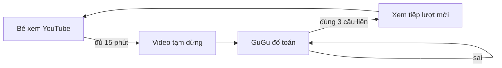

<p align="center">
  
</p>

<p align="center">
  
  
  
  <a href="LICENSE"></a>
</p>

<p align="center"><b>Tiếng Việt</b> · <a href="README.en.md">English</a></p>

**Xem YouTube 15 phút, giải đúng 3 câu toán thì xem tiếp.** B-SolveToWatch (trên TV tên là *GuGu Toán*) biến giờ
xem TV của bé thành những phút luyện toán ngắn: hết lượt, video tự dừng, chim cánh cụt GuGu ra đố, đúng liền 3 câu là
video chạy tiếp. Không cãi nhau, không giật remote.

Bạn không cần biết lập trình: **đưa repo này cho trợ lý AI** (Claude Code, Codex, Gemini CLI…), nó tự làm và cài lên TV
nhà bạn, theo đúng lớp của con.

> **Nếu bạn là AI agent:** đọc [AGENTS.md](AGENTS.md) và làm theo, từ bước 1.

| | |
|---|---|
|  |  |
| *Hết lượt: video dừng, GuGu đố toán, chọn đáp án bằng remote* | *Sai thì GuGu báo đáp án đúng, làm lại từ đầu* |

## Bắt đầu nhanh

Mở trợ lý AI trên máy tính cùng Wi‑Fi với TV và nói:

```
Lấy repo https://github.com/haobv/B-SolveToWatch về và làm theo hướng dẫn trong đó.
```

AI đọc repo, hỏi bạn vài câu, cài lên TV và thử cho bạn xem: khoảng **15–20 phút**. Bạn chỉ cần bật chế độ gỡ lỗi trên TV
và bấm *Allow* khi TV hỏi.

<details>
<summary><b>Cần chuẩn bị gì?</b></summary>

1. **TV Android TV / Google TV**, Android 8 trở lên: TCL, Sony, Xiaomi, Philips, Hisense dòng Google TV…
   Samsung, LG, Roku không dùng được.
2. **Bật gỡ lỗi:** Settings → System (hoặc Device Preferences) → About → bấm OK vào **Android TV OS build** 7 lần →
   quay lại → Developer options → bật **USB debugging** (và Network/ADB debugging nếu có).
3. **Máy tính cùng mạng Wi‑Fi** với TV, có trợ lý AI biết chạy lệnh. AI sẽ hỏi trước khi cài thêm công cụ
   (JDK 17, Android SDK, adb).
4. Khi AI kết nối, TV hiện **"Allow USB debugging?"**: tick *Always allow* rồi bấm OK.
</details>

## Cách hoạt động



Một dịch vụ trợ năng (Accessibility) chỉ đọc **app nào đang ở trên màn hình** để đếm giờ. Hết lượt, nó tạm dừng video và
mở màn đố toán. Bấm Back không thoát được; bấm Home rồi mở lại YouTube thì màn đố hiện lại ngay.

## Tính năng

| | |
|---|---|
| 🧮 **Toán đúng chương trình** | Lớp 3 theo GDPT 2018: cộng trừ trong phạm vi 1000, bảng nhân chia, biểu thức. Đáp án nhiễu sát đáp án đúng, không đoán mò được |
| 🐧 **Nhân vật GuGu** | Cô giáo khi đố, buồn khi sai, vui khi qua lượt. Thay được bằng nhân vật của nhà bạn |
| 🎯 **Cá nhân hoá** | Lớp, tên gọi bé, app bị chặn, số phút, số câu, ngôn ngữ: AI hỏi và làm theo |
| 🔒 **Bố mẹ toàn quyền** | Mã PIN; tạm tắt 1 giờ, 3 giờ hoặc đến hết hôm nay; thống kê trong ngày |
| 📺 **Hợp remote TV** | Chữ to, chọn bằng phím mũi tên, giao diện sáng kiểu Liquid Glass |
| 🛡️ **Riêng tư** | Không có quyền Internet, không quảng cáo, không tài khoản; không gỡ hay tắt app nào của TV |

## AI sẽ hỏi bạn

| Câu hỏi | Mặc định |
|---|---|
| Bé học lớp mấy? | Lớp 3 |
| Gọi bé là gì trên màn đố ("GuGu đố **Bin** nè!") | bé |
| Chặn app nào? (AI liệt kê app có trên TV) | YouTube |
| Mấy phút một lượt, mấy câu đúng liền? | 15 phút, 3 câu |
| Nhân vật: GuGu, ảnh nhà bạn gửi, hay không cần | GuGu |

## Bố mẹ chỉnh trên TV

Mở **GuGu Toán** trong danh sách app (hoặc bấm **Bố mẹ** trên màn đố), nhập PIN: bật/tắt, số phút mỗi lượt, số câu đúng
liền, tạm tắt, đổi PIN, và xem hôm nay bé đã xem bao lâu, đúng bao nhiêu câu. **PIN mặc định `0000`: đổi ngay sau khi cài.**

Đây là hàng rào cho trẻ nhỏ, không phải khoá tuyệt đối: người biết vào *Settings → Apps → Force stop* vẫn tắt được.

## Lộ trình

- [x] Lớp 3, chặn YouTube, nhân vật GuGu, cài bằng AI agent
- [ ] Lớp 1, 2, 4, 5 ([docs/curriculum.md](docs/curriculum.md) có sẵn khung)
- [ ] Giao diện tiếng Anh
- [ ] Ghi chú cho thêm hãng TV ([docs/devices.md](docs/devices.md))

## Đóng góp

Thêm một lớp, một hãng TV, hay sửa lỗi: xem phần *Changing this repo* trong [AGENTS.md](AGENTS.md). Mỗi pull request một
chủ đề, kèm ảnh chụp từ TV thật nếu thay đổi những gì bé nhìn thấy.

## Ghi công và giấy phép

- Cách "đưa repo cho AI làm theo" học từ [CleanYourTV](https://github.com/Gathin23/cleanyourtv), dự án dọn quảng cáo và
  thay launcher cho Android TV: dùng chung với app này rất hợp.
- Code: [MIT](LICENSE). Ảnh nhân vật GuGu: © haobv, dùng miễn phí trong app này, không dùng thương mại
  ([ASSETS-LICENSE.md](ASSETS-LICENSE.md)).

---

<p align="center"><sub><b>B-Series</b> by <a href="https://github.com/haobv">haobv</a> ·
<a href="https://github.com/haobv/B-SolveToWatch">B-SolveToWatch</a> ·
<a href="https://github.com/haobv/B-AutoLearn">B-AutoLearn</a></sub></p>
